# Jenkins Job Enhancement & Ansible Refactoring

## Step 1 – Jenkins Job Enhancement

Before beginning, enhancements are made to the Jenkins job configuration. Previously, each code change created a separate directory, which consumed storage space on the Jenkins server and hindered multi-command execution from a single path. A new Jenkins project is introduced using the `Copy Artifact` plugin.

1. A new directory named `ansible-config-artifact` is created on the `Jenkins-Ansible` server to store build artifacts:


```bash
sudo mkdir /home/ubuntu/ansible-config-artifact

```

2. Directory permissions are modified using `chmod -R 0777 /home/ubuntu/ansible-config-artifact` so Jenkins can save files into the directory.

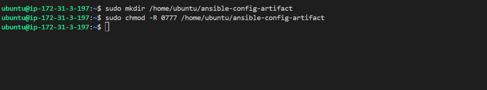

3. Within the Jenkins web console, the `Copy Artifact` plugin is installed without restarting Jenkins.
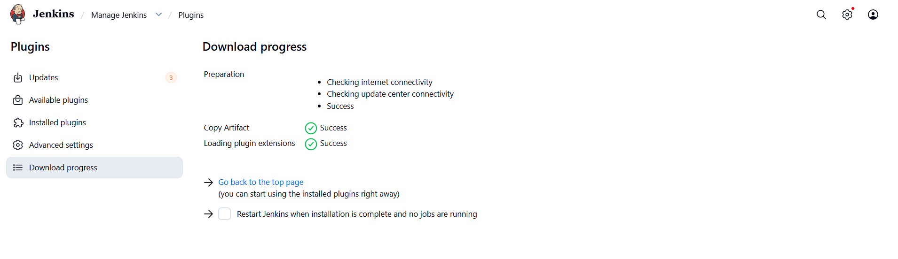

4. A new Freestyle project named `save_artifacts` is created.
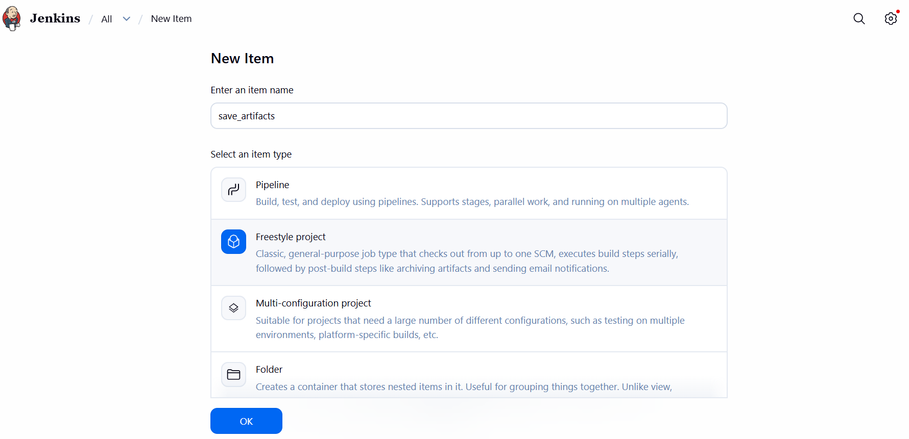

5. The project is configured to be triggered upon completion of the existing `ansible` project 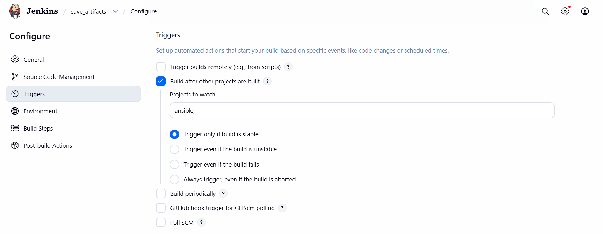. Log rotation is set up under the **Discard old builds** strategy with the **Max # of builds to keep** set to `2`.
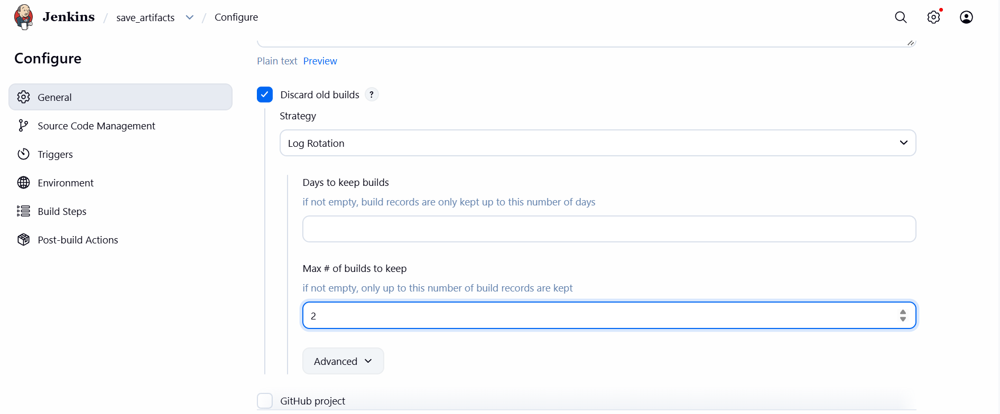
6. The main idea of save_artifacts project is to save artifacts into /home/ubuntu/ansible-config-artifact directory. To achieve this, create a Build step and choose Copy artifacts from other project, specify ansible as a source project and /home/ubuntu/ansible-config-artifact as a target directory  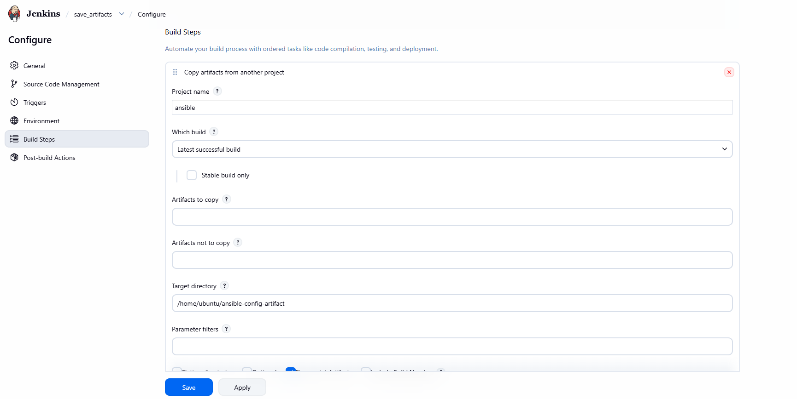 
7. Test the set up by making some change in README.MD file inside the ansible-config-mgt repository.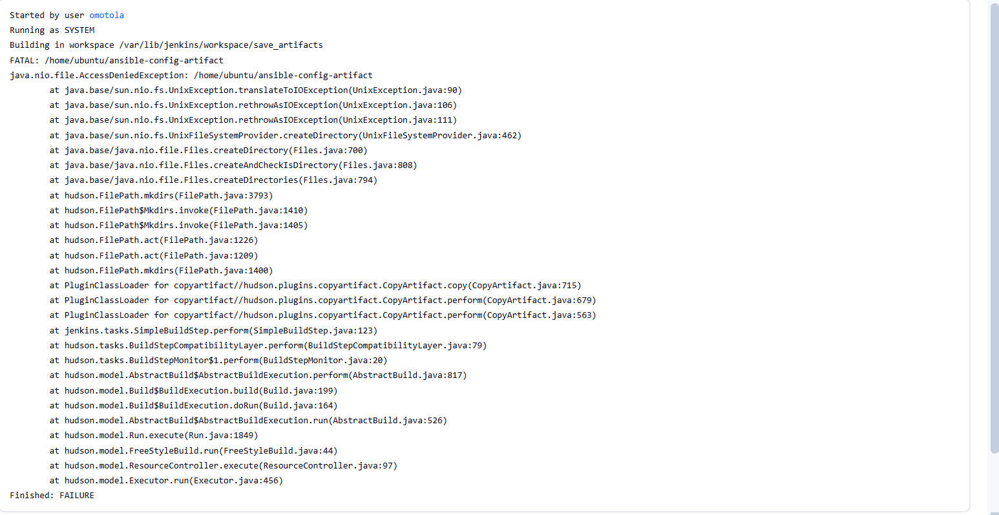

* **Issue**: The Jenkins artifact copy build failed with a java.nio.file.AccessDeniedException while attempting to access the target directory at /home/ubuntu/ansible-config-artifact. This happened because despite the target directory having 777 permissions (drwxrwxrwx), the jenkins user was blocked by the parent /home/ubuntu directory's 750 permissions (drwxr-x---),

* **Solution** This was fixed by running the following command to grant traversal rights: 
```bash
sudo chmod o+x /home/ubuntu 
```
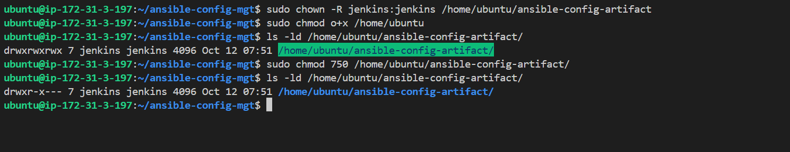
* **Result**: The next trigger resulted in a successful 'save_artifacts' build.
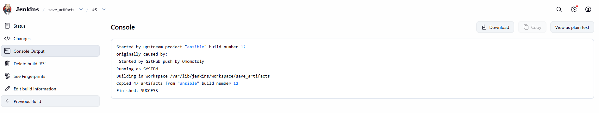

---

## Step 2 – Refactor Ansible Code by Importing Other Playbooks into `site.yml`

Prior to refactoring, the latest code is pulled down from the `main` branch, and a new working branch named `refactor` is created[cite: 3]. Refactoring allows complex playbook tasks to be broken down into modular components, avoiding cluttered and heavily commented files[cite: 3, 4].

1. Inside the `playbooks` directory, a new file named `site.yml` is created to serve as the main entry point for the entire infrastructure configuration.
git fetch
2. A new directory named `static-assignments` is created at the repository root to store child playbooks.
3. The `common.yaml` file is moved into the `static-assignments` directory.
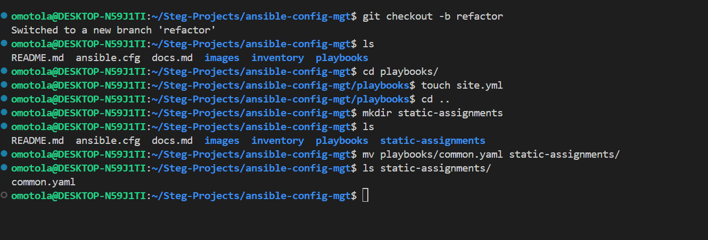

4. Inside `site.yml`, `common.yaml` is imported using the following structure:

```yaml
---
- hosts: all
- import_playbook: ../static-assignments/common.yml
```
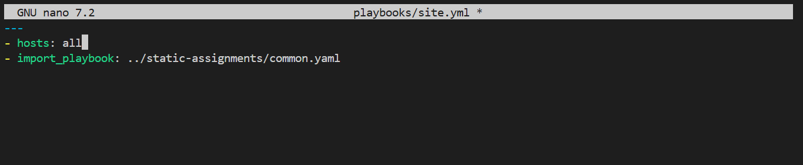
The directory structure is organized as follows:

```text
├── static-assignments
│   └── common.yaml
├── inventory
│   ├── dev
│   ├── stage
│   ├── uat
│   └── prod
└── playbooks
    └── site.yml
```

5. To configure package deletion, a new playbook named `common-del.yml` is created under `static-assignments` to remove the `wireshark` utility across target systems:

```yaml
---
- name: update web, nfs and db servers
  hosts: webservers, nfs, db
  remote_user: ec2-user
  become: yes
  become_user: root
  tasks:
    - name: delete wireshark
      yum:
        name: wireshark
        state: removed

- name: update LB server
  hosts: lb
  remote_user: ubuntu
  become: yes
  become_user: root
  tasks:
    - name: delete wireshark
      apt:
        name: wireshark
        state: absent
        autoclean: yes

```
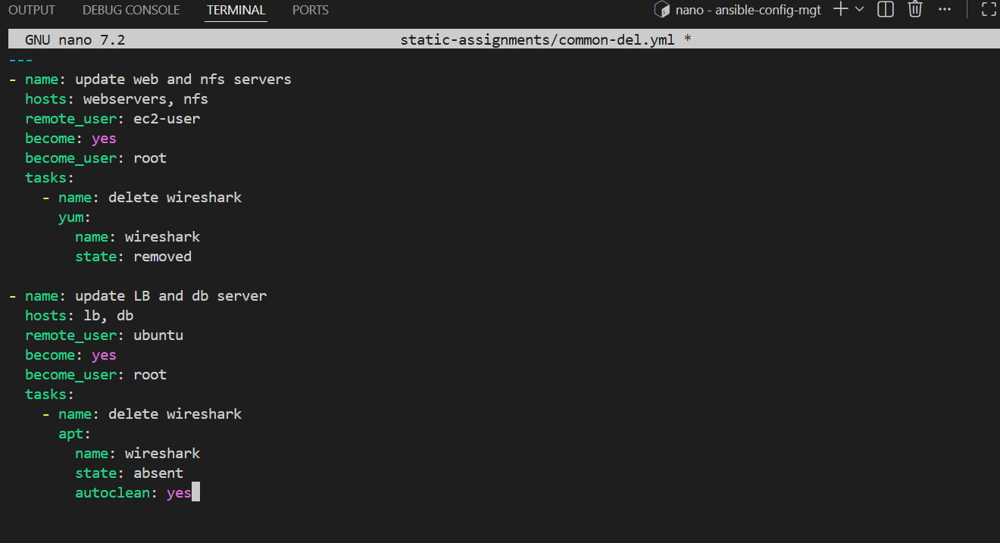

6. The reference in `site.yml` is updated to `- import_playbook: ../static-assignments/common-del.yml`

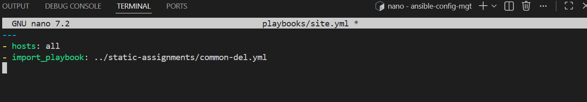

7. The Ansible playbook is executed against the `dev` environment:

```bash
cd /home/ubuntu/ansible-config-mgt/
ansible-playbook -i inventory/dev.yml playbooks/site.yaml
```
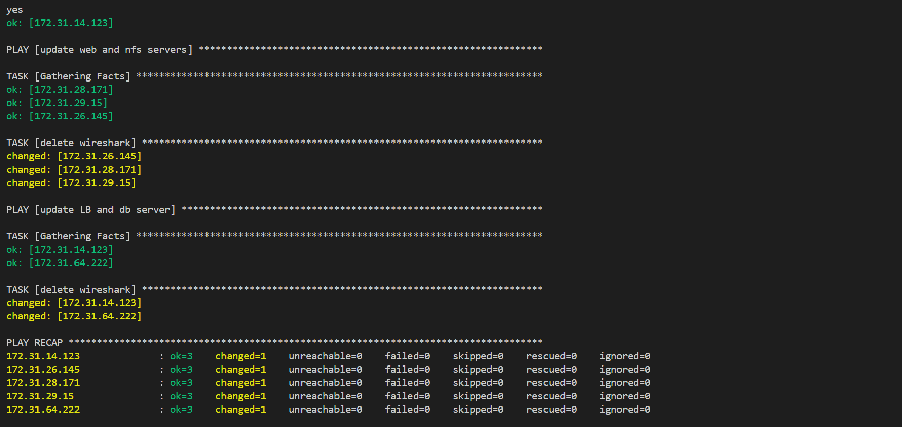

8. Uninstallation of `wireshark` across all target servers is verified by running

```bash
wireshark --version
```
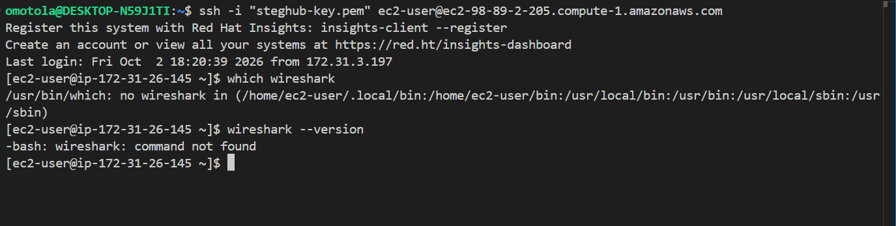

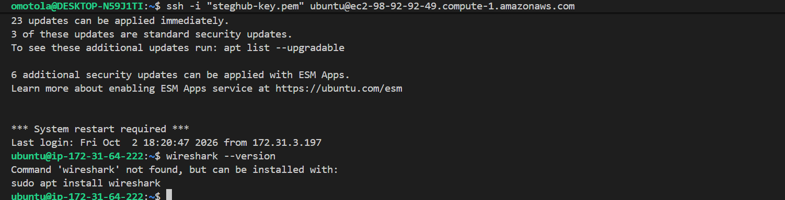

## Step 3: Configure UAT Webservers Using a Dedicated Role

### 1. Launch EC2 Instances
Provision two fresh **RHEL 8** EC2 instances to act as the UAT environment.
* `Web1-UAT`
* `Web2-UAT`
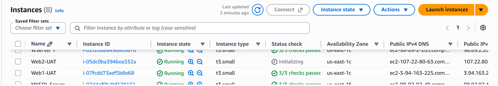

### 2. Set Up the Roles Directory Structure
Navigate to the root of the `ansible-config-mgt` repository and generate the scaffolding for a new `webserver` role using Ansible Galaxy:

```bash
mkdir roles
cd roles
ansible-galaxy init webserver
```

Confirm that the directory hierarchy was created correctly before proceeding.

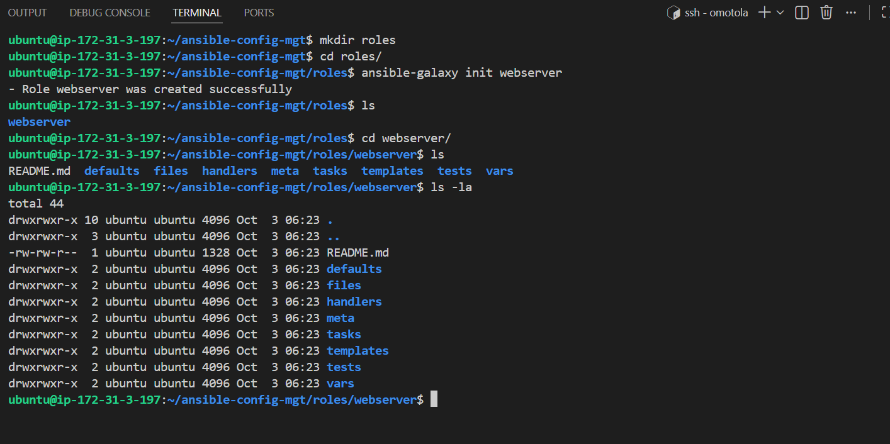


### 3. Update Environment Inventory

Edit the `inventory/uat.yml` file to register the private/public IP addresses of the two newly provisioned UAT servers:

```bash
nano inventory/uat.yml

```
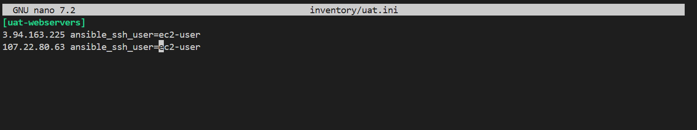

---

### 4. Update ansible.cfg to point at your roles directory.

Modify `/etc/ansible/ansible.cfg` to ensure Ansible can locate the newly initialized `roles/` directory:

```bash
sudo nano /etc/ansible/ansible.cfg
[defaults]
roles_path = /home/ubuntu/ansible-config-mgt/roles
```
## Troubleshooting: Missing `/etc/ansible/ansible.cfg`

While configuring Ansible, checking for the global configuration file failed because the `/etc/ansible/` directory does not exist by default.

* **Commands Executed:** `sudo nano /etc/ansible/ansible.cfg` and `ls -l /etc/ansible/ansible.cfg`
* **Error Output:** `No such file or directory`

### Root Cause
Modern Ansible package installations dont create `/etc/ansible/` by default to avoid overwriting user settings during updates.

### Resolution
Created the system-wide configuration file directly under '/etc/ansible/':
   ```bash
   sudo mkdir -p /etc/ansible
   sudo sh -c 'ansible-config init --disabled > /etc/ansible/ansible.cfg'
   ```
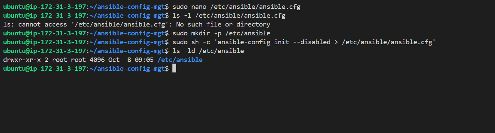

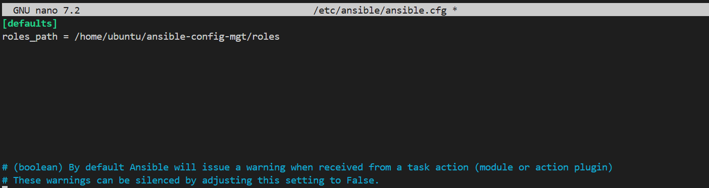
---

### 5. Define Webserver Tasks

Add the core configuration logic inside `roles/webserver/tasks/main.yml`. These tasks install Apache and Git, retrieve the Tooling web application source code, deploy it to the web root, and ensure the service remains running:

```bash
nano roles/webserver/tasks/main.yml
```
```yaml
---
- name: install apache
  become: true
  ansible.builtin.yum:
    name: "httpd"
    state: present

- name: install git
  become: true
  ansible.builtin.yum:
    name: "git"
    state: present

- name: clone a repo
  become: true
  ansible.builtin.git:
    repo: https://github.com/StegTechHub/tooling.git
    dest: /var/www/tooling-src
    force: yes

- name: copy html content to one level up
  become: true
  ansible.builtin.copy:
    src: /var/www/tooling-src/html/
    dest: /var/www/html/
    remote_src: yes
    mode: preserve

- name: Start service httpd, if not started
  become: true
  ansible.builtin.service:
    name: httpd
    state: started

```
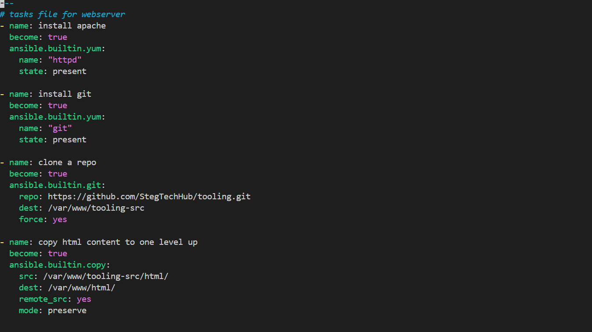

---

## Step 4: Reference the Webserver Role via Static Assignments

### 1. Create the UAT Assignment

Create a new assignment file within `static-assignments` to bind the target host group to the `webserver` role:

```bash
cd ~/ansible-config-mgt/static-assignments
nano uat-webservers.yml

```

Add the following play definition:

```yaml
---
- hosts: uat-webservers
  roles:
     - webserver

```

---

### 2. Update Entry Point Playbook

Import the new static assignment into the main playbook file (`playbooks/site.yml`):

```bash
nano playbooks/site.yml

```

```yaml
---
- import_playbook: ../static-assignments/common.yml
- import_playbook: ../static-assignments/uat-webservers.yml

```
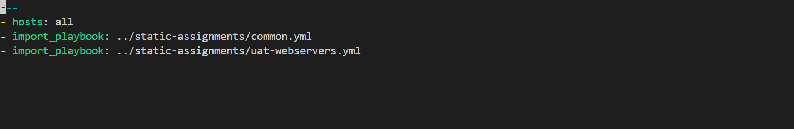

---

## Step 5: CI/CD Pipeline Verification and Execution

### 1. Version Control and Automated Builds

1. Push local changes to GitHub, open a Pull Request, and merge into the `main` branch.
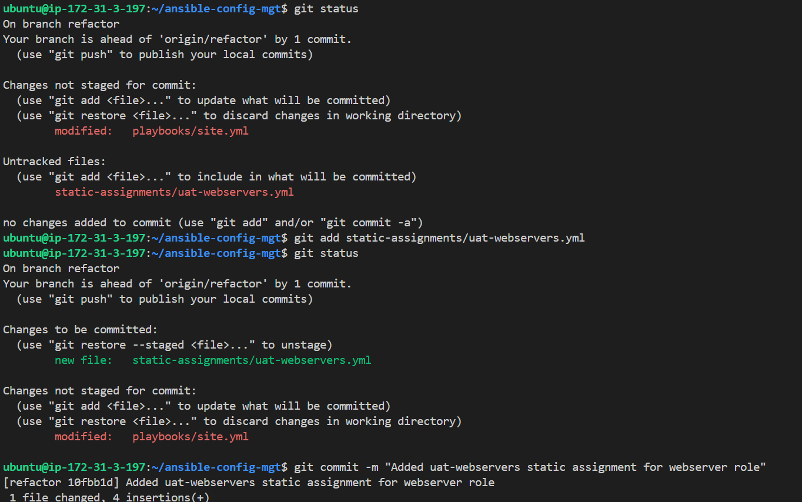
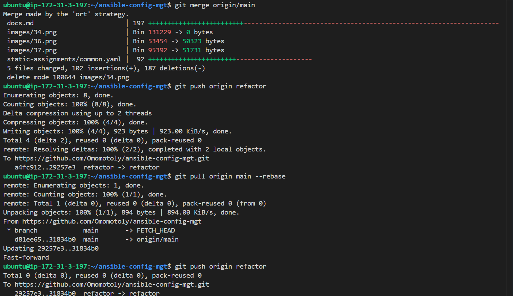

   
2. Confirm that the GitHub webhook triggers the automated pipeline:
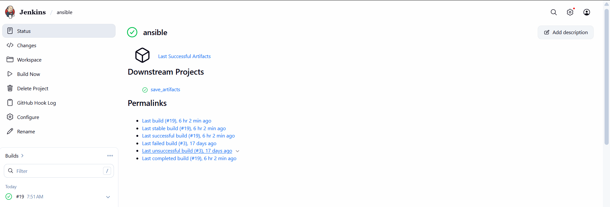

* Verification via Jenkins Console Output (e.g., `save_artifacts` build #3) confirms successful artifact transfer:
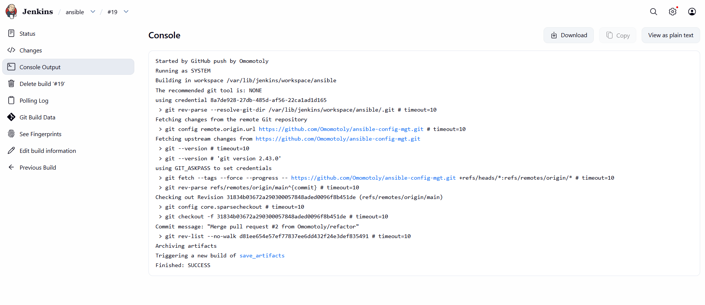


* This validates that all updated files were deployed automatically to `/home/ubuntu/ansible-config-mgt/` on the Jenkins-Ansible control node.


---

### 2. Playbook Pre-flight Checks

Before executing the deployment, run structural preview, syntax, and linting checks from the control server:

```bash
# Preview task structure
ansible-playbook -i inventory/uat.yml playbooks/site.yml --list-tasks
```

### Issue

Running `ansible-playbook -i inventory/uat.yml playbooks/site.yml --list-tasks` failed with two errors:

1. **Inventory Error:** Used `uat.yml` instead of the actual `uat.ini` file in `inventory/`.
2. **Missing File Error:** The static assignment import referenced .yml instead of the existing .yaml file.
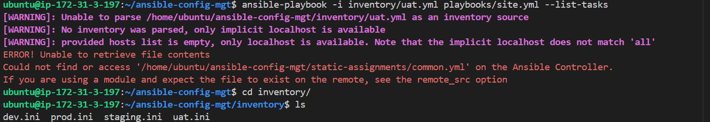

---

### Resolution

1. Corrected the inventory file name in the command from `uat.yml` to `uat.ini`.
2. Updated the import path extension from common.yml to common.yaml to match the file system.

**Fixed Command:**

```bash
ansible-playbook -i inventory/uat.ini playbooks/site.yml --list-tasks

```
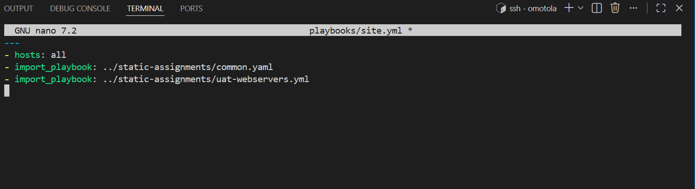
Run the command again:
```
ansible-playbook -i inventory/uat.ini playbooks/site.yml --list-tasks
```
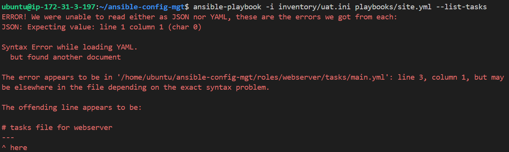

### Issue
Ansible threw a YAML syntax error because of duplicate document separators (---) at the top of roles/webserver/tasks/main.yml.

  **Resolution:** Removed the extra --- line so the file starts with a single YAML header.

  **Result:** Ansible parsed the inventory successfully, loaded the static assignment file, and displayed the task list.

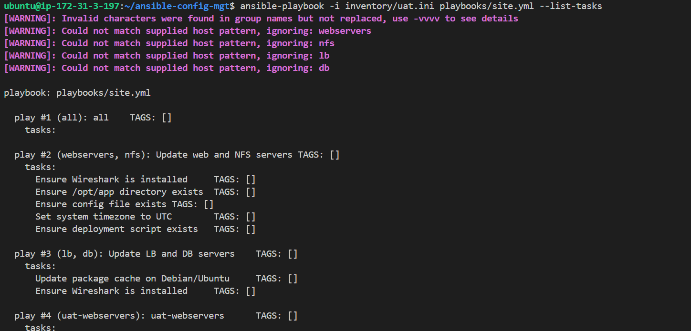

# Validate playbook syntax
```
ansible-playbook -i inventory/uat.ini playbooks/site.yml --syntax-check
```
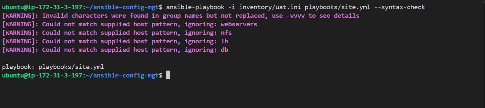

---

### 3. Playbook Execution & Verification

Run the playbook against the UAT environment inventory:

```bash
ansible-playbook -i inventory/uat.ini playbooks/site.yml
```
NOTE: Before running the playbook, ensure you have tunneled into your Jenkins-Ansible server via ssh-agent

---

Here is the updated documentation with the chronological order adjusted so that the initial diagnostic check comes first to establish the server's local state, followed by the configuration resolution and verification:

---

### Issue 1: Default Index Mismatch

* **Issue:** Apache was configured to look for `index.html` by default, but the web root directory (`/var/www/html`) only contained `.php` files, resulting in a `403 Forbidden` error.
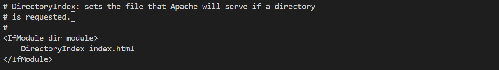

* **Initial Diagnostic Check:** Tested locally using `curl -i http://localhost`, which successfully returned `HTTP/1.1 200 OK`, confirming the Apache service was running locally.
* **Resolution:** Updated the `DirectoryIndex` directive in `/etc/httpd/conf/httpd.conf` to include `index.php`. 
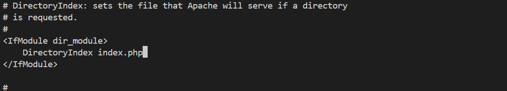

Verified syntax using `sudo httpd -t` and restarted the service with `sudo systemctl restart httpd`.
* **Results:** Apache successfully identified `index.php` as the default landing page.

---

### Issue 2: External Network Connection Timeout

* **Issue:** Incoming web traffic on port 80 was blocked at the network level, preventing external access while local server requests succeeded.
* **Error Message:** `ERR_CONNECTION_TIMED_OUT` ("took too long to respond") in the browser / `curl: Failed to connect to port 80: Connection timed out` when running `curl -i http://<public-ip>`.
* **Resolution:** Opened the AWS EC2 console and added an inbound security group rule for HTTP traffic on Port 80 (`0.0.0.0/0`).
* **Results:** External requests from the browser and remote clients successfully reached the EC2 instance and loaded the application.
---
### Issue 3: Browser Protocol Mismatch

* **Issue:** The web browser automatically attempted to secure the connection using an unconfigured protocol(https).
* **Error Message:** Connection refused / site cannot be reached via HTTPS.
* **Resolution:** Explicitly entered `http://<your-public-ip>` in the browser address bar to force standard HTTP.
* **Results:** The browser successfully loaded the application pages without protocol errors.
  
Once execution finishes, verify that both `Web1-UAT` and `Web2-UAT` respond in a web browser by navigating to their public IP addresses to view the active Tooling application.
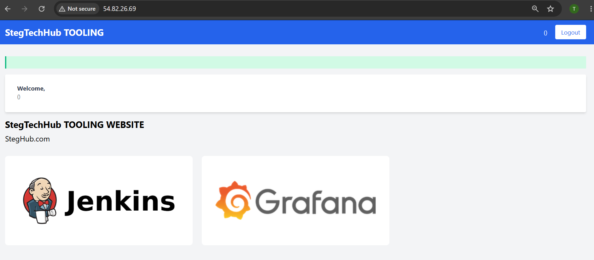
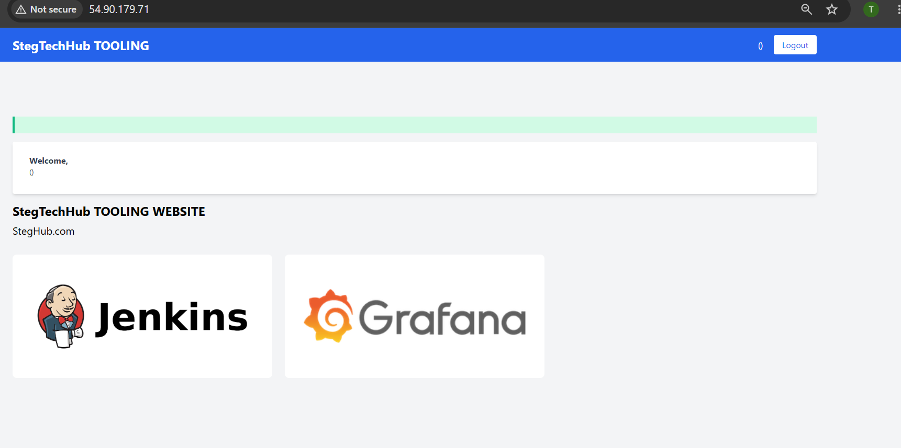

---

### Verification of Idempotency

To verify that the implementation is fully idempotent, the playbook was executed a second time without altering any underlying files or server configurations.

The task output for every step returned `ok`, culminating in a final recap showing `changed=0` across all hosts:

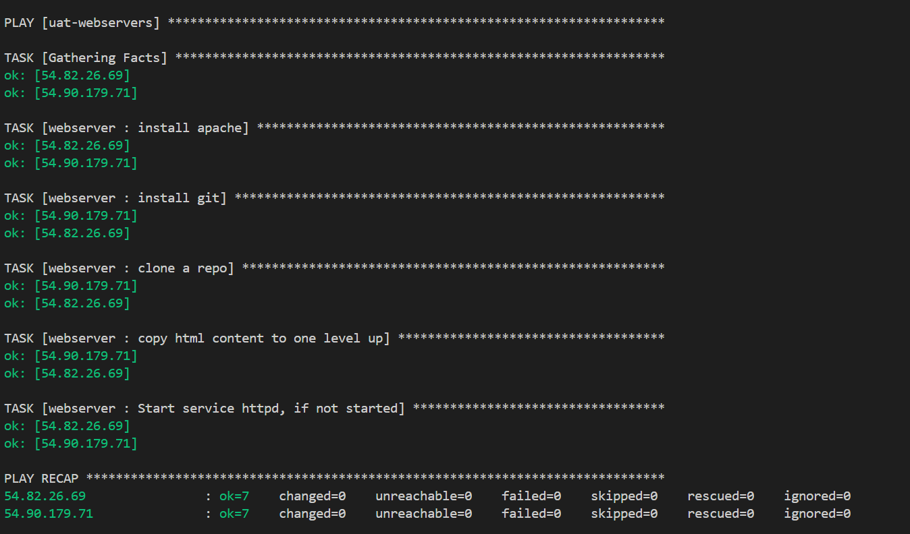


This confirms that Ansible makes zero state modifications when the actual infrastructure state matches the desired configuration.

---

## Conclusion

This project successfully refactored the Ansible codebase into a modular, maintainable architecture leveraging roles and static assignments. By breaking monolithic playbook logic into isolated role tasks under `roles/webserver/` and importing them via `playbooks/site.yml`, the environment can now scale efficiently across diverse infrastructure stages.

Key outcomes included:

* **Pipeline Integration:** Validated automated webhook deployment via Jenkins to streamline configuration delivery from GitHub to the Ansible controller.
* **Defensive Task Design:** Identified and resolved a source repository misconfiguration during initial testing.
* **Idempotency Standards:** Replaced non-idempotent shell execution paths with checksum-aware modules (`ansible.builtin.copy`), guaranteeing predictable convergence on repeated runs.
* **Least-Privilege Security:** Standardized control node permissions to `750` with `jenkins:jenkins` ownership rather than permissive `0777` access models.

```

```
